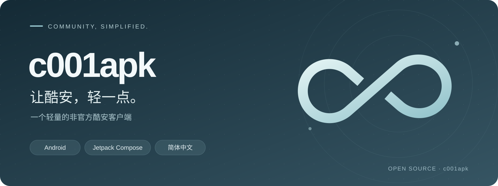

# c001apk

**轻量、简体中文的非官方酷安客户端**

[下载](https://github.com/Costben/c001apk/releases) · [反馈问题](https://github.com/Costben/c001apk/issues) · [参与开发](docs/DEVELOPMENT.md)

## 关于

基于 [c001apk-flutter](https://github.com/bggRGjQaUbCoE/c001apk-flutter) 继续维护，修复 API、完善中文体验，让日常浏览保持轻巧。

<table align="center">
  <thead>
    <tr>
      <th align="center">浏览内容</th>
      <th align="center">找到兴趣</th>
      <th align="center">按你的习惯</th>
    </tr>
  </thead>
  <tbody>
    <tr>
      <td align="center">动态、文章、评论、用户空间</td>
      <td align="center">动态、应用、用户、话题与内容搜索</td>
      <td align="center">明暗主题、字体大小</td>
    </tr>
    <tr>
      <td align="center">图文详情与图片查看</td>
      <td align="center">应用、话题及产品详情</td>
      <td align="center">本地收藏与屏蔽、浏览历史</td>
    </tr>
    <tr>
      <td align="center">Markdown 正文、代码与表格</td>
      <td align="center">c001apk 小助手公告</td>
      <td align="center">保存为 Markdown / 离线 HTML</td>
    </tr>
  </tbody>
</table>

## 界面预览（2026-10-20，Android 2.0.2 / Windows 1.2.5）

  
  

Android · 首页 / 动态详情

  
  

Android · 搜索与筛选 / 设置

  

Windows · 桌面端首页（Flutter 1.2.5）

  

Windows · 分类设置与宽窗口布局（Flutter 1.2.5）

## 下载安装

正式安装包可从 [Releases](https://github.com/Costben/c001apk/releases) 获取，也可以参照 [开发指南](docs/DEVELOPMENT.md) 自行构建。

云端构建包可从 [Actions](https://github.com/Costben/c001apk/actions/workflows/build.yml) 的 Artifacts 下载，平台、签名与手动构建方式见 [云端构建指南](docs/CI.md)。

## 开发进度

- [x] 更新公共 API 请求协议、签名与错误处理。
- [x] 完成现有 Flutter 界面的一轮简体中文汉化。
- [x] 恢复主要游客浏览流程，为部分受限动态、文章提供公开详情回退。
- [x] 基本修复账号登录与状态管理，补齐验证码交互。
- [x] 本地关注与悄悄关注、多账号管理及游客模式切换。
- [x] 主导航与分类设置调整，新增 c001apk 自身更新检测。
- [x] 修复评论完成验证后仍无法加载，更新检测改为每次冷启动检查一次。
- [ ] 继续完善验证码放行与部分账号操作。
- [x] Android 迁移到 Kotlin / Jetpack Compose，采用 [coui17](https://github.com/Costben/coui17) ColorOS 风格组件库：主导航、信息流、详情与回复、搜索与筛选、用户 / 应用 / 话题 / 酷图、浏览历史与设置均已接通，见 [开发指南](docs/DEVELOPMENT.md#android-compose-应用)。
- [x] Android Compose 版补齐搜索内容类型与排序筛选、级联三点菜单、浏览历史原位展开、楼主置顶回复与缩略图加载修复。
- [ ] 完善 Flutter 桌面端随窗口尺寸变化的自适应布局与图片保存。

当前重点维护 **Android 与 Windows**。Android 端已迁移到 Kotlin / Jetpack Compose，界面使用 coui17，包名为 `app.awavenue.c001apk.coui`；Windows 桌面端仍使用 Flutter。Linux 已通过云端 release 构建，iOS `arm64` 未签名 IPA 已随 [1.2.6-release](https://github.com/TG-Twilight/c001apk/releases/tag/1.2.6-release) 提供，安装前需自行签名。Linux / iOS 运行体验仍待验收。新包与旧包独立安装，登录及本地数据不会自动迁移。

> [!NOTE]
> 部分内容仍受登录、验证码和服务端接口限制，验证码放行与部分账号操作仍需继续完善。Windows 暂不支持应用内直接保存图片，可在浏览器中打开后保存。

## 参与与致谢

欢迎提交 [Issue](https://github.com/Costben/c001apk/issues) 或 Pull Request。反馈请附平台、版本、复现步骤与脱敏错误信息；开发环境、工程目录及检查命令见 [开发指南](docs/DEVELOPMENT.md)。

感谢 [bggRGjQaUbCoE/c001apk-flutter](https://github.com/bggRGjQaUbCoE/c001apk-flutter) 的开源，以及 [daimiaopeng/coolapk-desktop](https://github.com/daimiaopeng/coolapk-desktop) 的协议调研参考。

本项目沿用 [GNU AGPL v3](LICENSE)，第三方来源与 MIT 许可见 [第三方声明](docs/THIRD_PARTY_NOTICES.md)。本项目与酷安官方无隶属关系，酷安名称、商标及服务内容归相应权利人所有。
